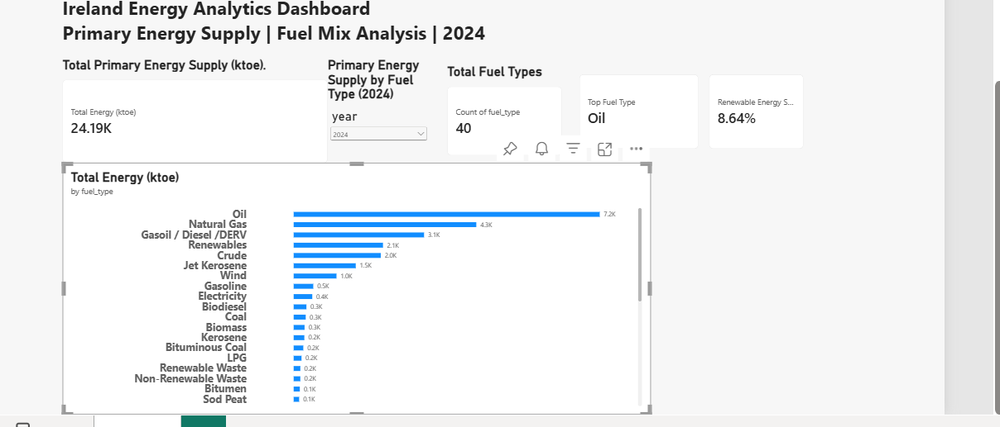
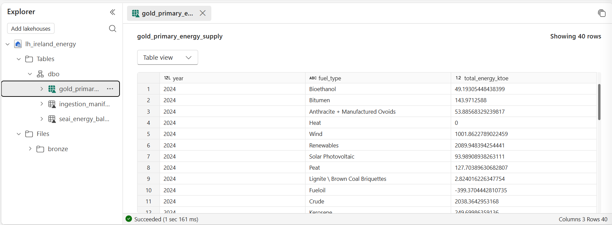
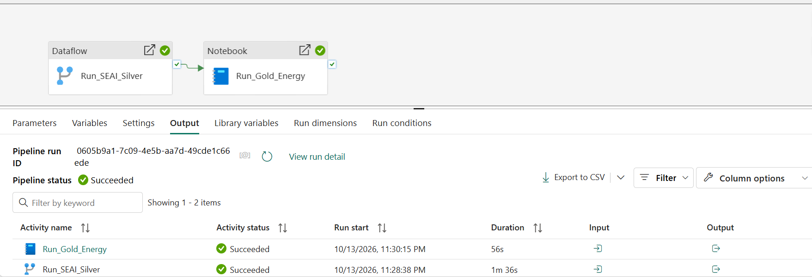

# Ireland Energy Analytics | Microsoft Fabric End-to-End Project

## Project Overview
An end-to-end data engineering and business intelligence project analyzing Ireland's primary energy supply using Microsoft Fabric, SQL, PySpark, Dataflow Gen2, and Power BI.

The solution implements a Bronze–Silver–Gold data architecture, automated ETL orchestration, data quality validation, and interactive energy reporting.

## Technology Stack
- Microsoft Fabric
- OneLake and Lakehouse
- Dataflow Gen2 / Power Query
- PySpark and Fabric Notebooks
- Delta Lake
- SQL
- Power BI and DAX
- Fabric Data Pipelines
- GitHub

## Data Source
SEAI National Energy Balance data, with a primary energy supply analysis for 2024. The project also includes Bronze ingestion folders for SEAI and EPA data.

## Data Architecture
Source Data
    |
    v
Bronze Layer - Raw Data in Fabric Lakehouse
    |
    v
Silver Layer - Dataflow Gen2 Cleaning and Transformation
    |
    v
Gold Layer - PySpark Aggregation and Analytical Tables
    |
    v
Semantic Model - Power BI DAX Measures
    |
    v
Power BI - Ireland Energy Analytics Dashboard

## Data Pipeline
Pipeline: `pl_ireland_energy_etl`

1. `Run_SEAI_Silver` executes the Dataflow Gen2 transformation `df_seai_silver`.
2. On successful completion, `Run_Gold_Energy` executes the Fabric notebook `nb_gold_energy`.
3. The pipeline was validated and executed successfully, with both activities reporting Succeeded.

Execution evidence is available in the `pipelines/` and `screenshots/` folders.

## Data Quality
SQL validation includes:
- Total records and energy reconciliation
- Duplicate detection
- Data quality checks on transformed tables

See `sql/energy_validation.sql` and the other SQL scripts.

## Power BI Dashboard
The Ireland Energy Analytics Dashboard provides:
- Total Primary Energy Supply
- Total Fuel Types
- Top Fuel Type
- Renewable Energy Share
- Primary Energy Supply by Fuel Type
- Year filtering

### Dashboard Preview




### 2024 Dashboard Results
- Total primary energy supply: 24,186.71 ktoe
- Fuel types displayed in the KPI: 40
- Top fuel type: Oil
- Renewable energy share: 8.64%

The renewable share measure uses the Renewables fuel category divided by total primary energy supply.

The report file is available at:
`powerbi/Ireland Energy Analytics Dashboard.pbix`

## Repository Structure
```text
ireland-energy-fabric/
├── dax/
├── docs/
├── notebooks/
├── pipelines/
├── powerbi/
├── sample_data/
├── screenshots/
├── sql/
└── README.md
```

## Project Deliverables
- Fabric Lakehouse with Bronze, Silver, and Gold data processing
- Dataflow Gen2 transformations
- PySpark notebook processing
- SQL validation scripts
- DAX measures
- Power BI report
- Successfully executed Fabric ETL pipeline
- GitHub project documentation and execution evidence

## Future Improvements
- Configure and test scheduled pipeline execution
- Add automated quality alerts
- Expand year-over-year reporting
- Add additional EPA emissions analysis

## Author
Roshith Mettu

Data Analytics | Microsoft Fabric | SQL | Power BI | PySpark

## Final Data Quality Validation

The Ireland Energy Analytics project includes SQL-based quality checks to verify data completeness, consistency, uniqueness, and accuracy across the Silver and Gold layers.

### Validation Results — 2024

| Validation Check | Result | Status |
|---|---|---|
| Gold Layer records | 40 | Passed |
| Unique fuel types | 40 | Passed |
| Null fuel types | 0 | Passed |
| Null energy values | 0 | Passed |
| Duplicate year/fuel combinations | 0 | Passed |
| Silver–Gold energy reconciliation | 24,186.71 ktoe in both layers | Passed |
| Total primary energy supply | 24,186.71 ktoe | Passed |
| Renewable energy | 2,089.95 ktoe | Passed |
| Renewable energy share | 8.64% | Passed |
| Fabric ETL pipeline | Both activities succeeded | Passed |

### Negative Energy Values

Four negative energy values were identified during validation.

These values were retained rather than automatically removed because negative entries may represent legitimate adjustments within energy balance reporting.

Further verification against the original SEAI source definitions is required to confirm their meaning.

### Pipeline Execution

The Microsoft Fabric pipeline `pl_ireland_energy_etl` successfully executed the following activities in sequence:

1. `Run_SEAI_Silver` — Dataflow Gen2 transformation.
2. `Run_Gold_Energy` — PySpark Gold Layer aggregation.

Both activities completed successfully.

### Validation Evidence







### Final Outcome

The project demonstrates an end-to-end Microsoft Fabric analytics workflow using Dataflow Gen2, Lakehouse, PySpark, SQL, Delta tables, pipeline orchestration, and Power BI.

The validated 2024 energy dataset supports reporting on Ireland's primary energy supply and fuel mix. All tested reconciliation, completeness, and uniqueness checks passed, with negative energy entries documented for further source-level review.

